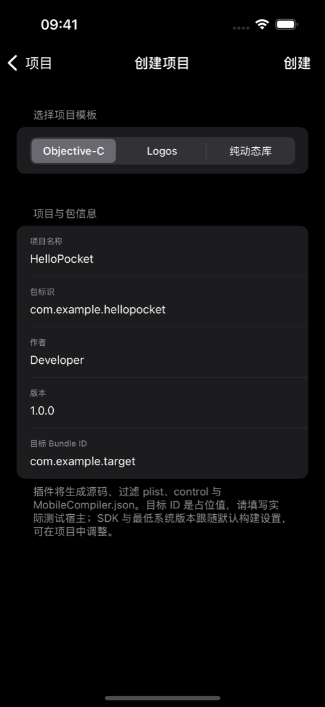
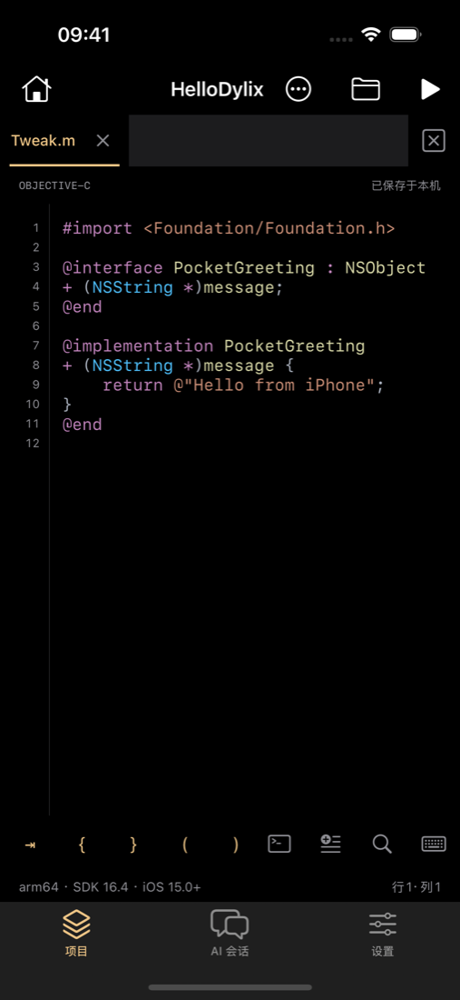
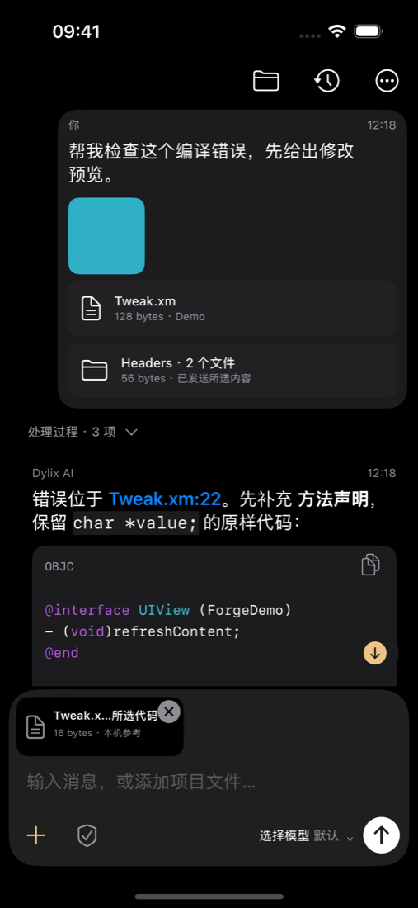
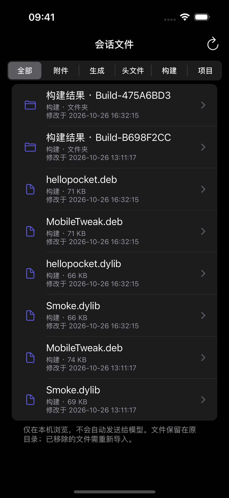
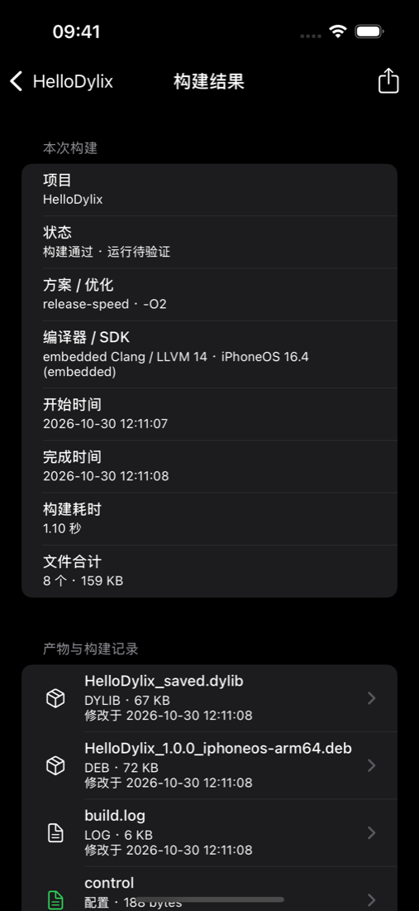
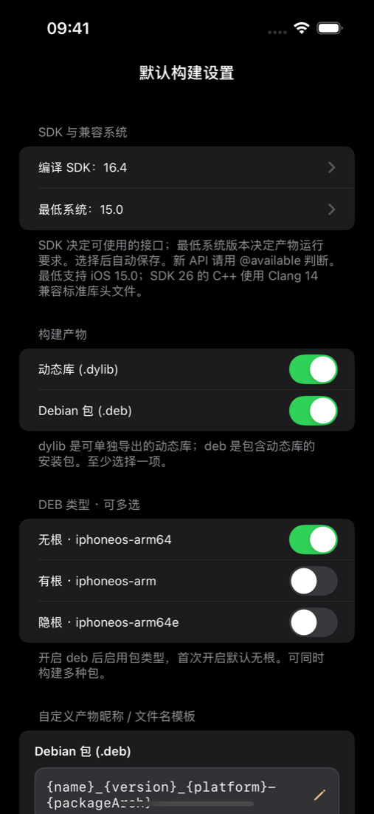
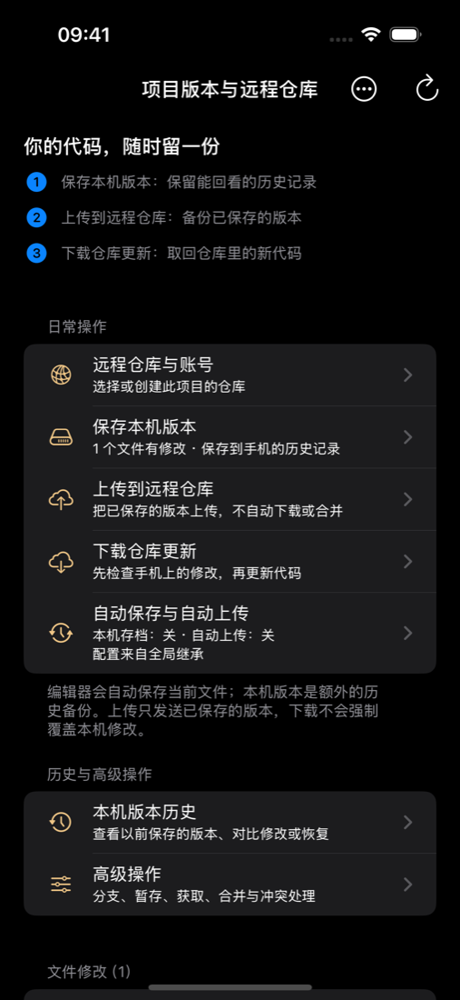
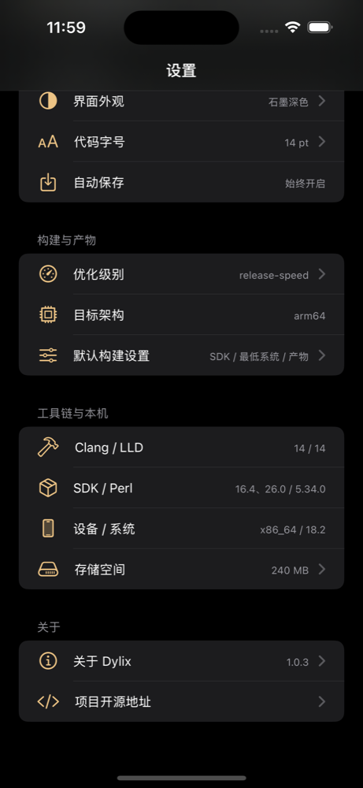

<div align="center">

# Dylix

**把插件开发工作台，放进口袋。**

iPhone / iPad 本机构建 · AI 开发助手 · 项目与 Git · 二进制工具

[](LICENSE)
[](#构建与安装)
[下载 IPA](https://github.com/yangokok886/dylix/releases/latest) · [界面预览](#界面预览) · [更新日志](CHANGELOG.md) · [构建文档](docs/BUILDING.md) · [第三方许可](THIRD_PARTY_NOTICES.md) · [问题与建议](https://github.com/yangokok886/dylix/issues)

</div>

当前版本：**1.0.4（135）**。AI 支持切换 SDK、初始化 Theos 项目、按编号清理构建；会话文件显示时间。

## 这是什么

Dylix 是原生 iOS 插件开发工作台：在手机上管理源码、编辑代码、调用内嵌 Clang / LLD 和 Logos，并生成 dylib 与 deb。AI 可以按权限读取头文件、解释代码、修改项目、检查构建结果；编译工作在设备本机完成。

它使用进程内 LLVM 工具链，并非完整 Theos shell 环境。现有 Theos 工程会经过受支持的 Makefile / 配置解析；任意脚本、Xcode 工程和完整 make 语义并不等同于已支持。

## 可以做什么

- **本机构建**：Objective-C、Objective-C++、C、C++、Logos；dylib 与 deb；多种包布局与产物命名。
- **项目与编辑**：模板创建、源码导入、文件浏览、语法着色、查找替换、项目配置、构建诊断及修改备份。
- **AI 工作流**：多连接/多协议、流式 Markdown、代码块、思考与工具过程折叠、编辑重发、会话文件入口。
- **普通会话也能开发**：列出、创建、克隆及选择项目，经目标确认后在原会话中继续编辑与构建。Git、下载、写入等操作遵循当前权限策略。
- **文件与版本管理**：系统分享导入、只读目录授权、附件按需读取；libgit2 本地版本与 GitHub / Gitee 同步。
- **本地分析工具**：IPA Objective-C 头文件导出、Mach-O / dylib 静态信息检查、离线崩溃分析与符号匹配。
- **后台辅助与存储**：系统后台任务、可选音频辅助、完成通知、分类及按文件清理。

## 界面预览

从打开项目、编写源码，到让 AI 协作、在本机生成产物，主要操作都在同一个原生工作台中完成。

### 写代码，也管理整个项目

<p align="center">
  
  &nbsp;&nbsp;
  
</p>

项目模板、最近项目、文件标签、语法着色与编辑快捷栏。当前架构、SDK 和最低系统版本直接显示在编辑器底部。

### AI 协作，过程和正文各有位置

<p align="center">
  
  &nbsp;&nbsp;
  
</p>

回复支持 Markdown 与独立代码块，处理过程可以折叠；附件、项目文件和生成内容从会话文件入口查找。开发操作按当前权限执行，普通会话也能创建或选择项目。

### 本机构建，产物有据可查

<p align="center">
  
  &nbsp;&nbsp;
  
</p>

内嵌 Clang / LLD 与 Logos，在设备本机编译；查看构建记录、导出 dylib / deb。SDK 16.4 / 26.0 可选，最低系统和包布局按项目配置。

### 版本管理与工作台设置

<p align="center">
  
  &nbsp;&nbsp;
  
</p>

本地 Git 管理变更、提交与历史，远程支持 GitHub / Gitee。工作台集中提供编辑器、存储空间、开发工具和许可证入口。

> 截图来自开源版 Build 134 的 iOS 模拟器；项目与 AI 对话使用演示数据。构建产物截图来自示例项目的实际本地编译；编译通过仍需在目标设备和宿主中验证运行效果。

## 构建与安装

开发主机为 macOS + Xcode / Apple Command Line Tools，另需 Python 3、CMake、Rust stable。
App 最低目标为 iOS 15；部分界面和后台能力按系统版本启用。当前模拟器构建脚本使用 x86_64（Apple Silicon 主机需安装适用的模拟器运行环境或自行扩展架构）。

```sh
git clone https://github.com/yangokok886/dylix.git
cd dylix
python3 scripts/fetch_toolchain.py
rustup target add aarch64-apple-ios x86_64-apple-ios
python3 scripts/build.py --sdk-root LocalSDKs/iPhoneOS26.0.sdk
```

输出 `build/Dylix-1.0.4-build135-unsigned.ipa`。安装前使用自己的证书/适用安装方式处理主 App、Share Extension 和嵌套 framework 签名。仓库不包含个人证书、描述文件或共享 API 密钥。

**两个 SDK 角色不同**：`--sdk-root` 决定 Dylix App 自身的构建 SDK；内嵌插件构建 SDK 可选 16.4 / 26.0，默认仍为 **SDK 16.4 + 最低 iOS 15**。

完整环境配置、模拟器构建、依赖来源、测试与签名说明见 [docs/BUILDING.md](docs/BUILDING.md)。仓库附带 SDK 16.4 与 26.0 构建输入；Apple SDK 保留 Apple 原有条款，不适用本项目 GPL。工具链通过下载脚本自动还原。

## AI、隐私与运行边界

模型连接由用户配置，API 密钥保存在系统钥匙串。发送聊天或调用读取工具时，相应文本会提交到选定模型服务；联网搜索也会访问对应服务。文件夹授权是按需只读访问，不会一开始把全部文件上传。

项目写入、构建和 Git 操作使用注册工具与范围校验；完全访问只针对当前项目。后台运行受 iOS 调度、音频中断、设备资源及用户设置影响，并非永久保活保证。

IPA 导出依据 Objective-C 元数据，不等于还原源码。加密镜像会被识别并跳过；本项目没有通用解密或任意二进制执行入口。编译成功也不证明插件在目标 App 内的运行效果。

设置中的“项目开源地址”打开本仓库，其下“软件许可证”可离线查看 GPL 完整条款。问题与建议请通过 GitHub Issues 提交并先脱敏。

## 许可证与致谢

**开发协作**：本项目由 Xuegao 主导开发，OpenAI Codex / ChatGPT 辅助实现、调试与文档编写。

Dylix 原创代码与修改采用 **GNU General Public License v3.0 or later（GPL-3.0-or-later）**，完整条款见 [LICENSE](LICENSE)。分发修改版或二进制时，请遵循 GPL 对相应源码、许可文本和必要构建材料的要求；软件按现状提供，不附带担保。

第三方代码保留原许可证，详见 [THIRD_PARTY_NOTICES.md](THIRD_PARTY_NOTICES.md)。感谢 LLVM / Clang / LLD、ios_system、Perl、Theos Logos、libgit2、REipa、MBProgressHUD、highlight.js、diff2html 等项目。第三方许可不因本项目采用 GPL 而被替换。

欢迎通过 [贡献说明](CONTRIBUTING.md) 一起改进 Dylix。
